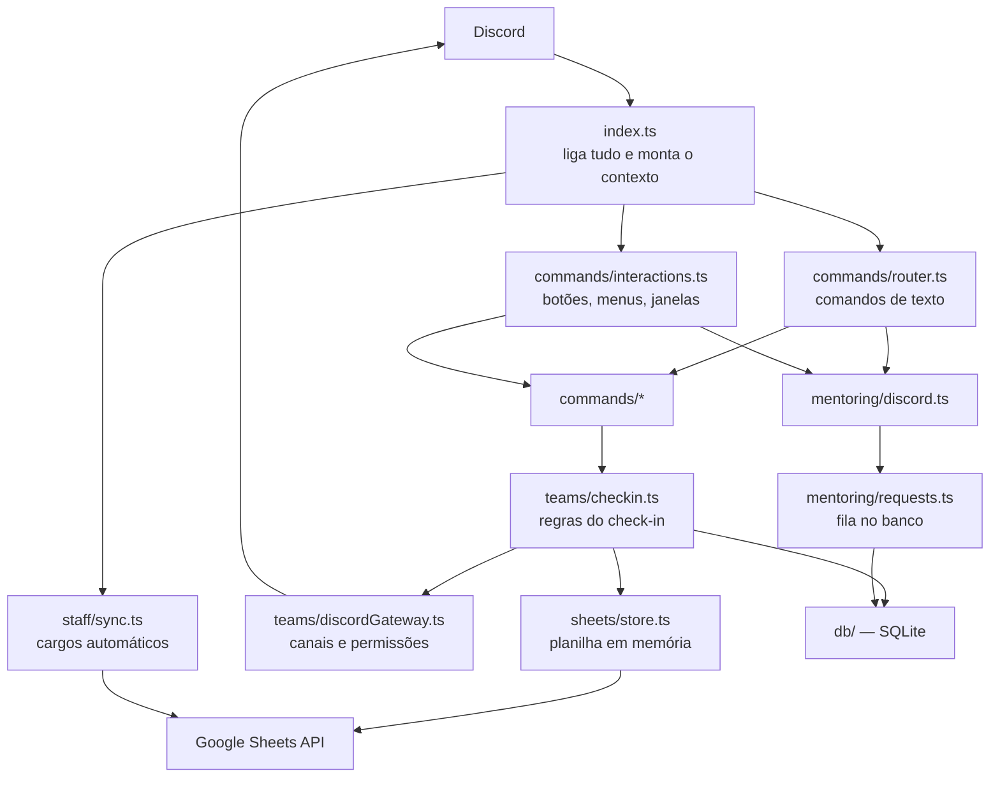
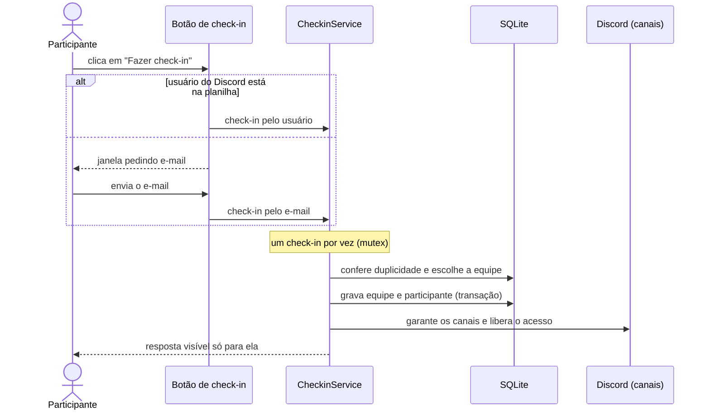

# Smartinho Bot

Bot de Discord para organizar hackathons. Ele cuida do **check-in** pela planilha de inscrições, cria **canais privados para cada equipe**, registra a **escolha de desafio**, mantém uma **fila de mentoria** e dá cargos de **mentor e organização** automaticamente.

A mesma base de código atende vários servidores ao mesmo tempo, cada um como uma cópia separada do bot, com idioma (português ou inglês), textos, planilhas e banco próprios.

## Sumário

- [Funcionalidades](#funcionalidades)
- [Tecnologias](#tecnologias)
- [Instalação](#instalação)
- [Configuração](#configuração)
- [Comandos](#comandos)
- [Vários servidores](#vários-servidores)
- [Como funciona](#como-funciona)
- [Testes](#testes)
- [Segurança e privacidade](#segurança-e-privacidade)
- [Solução de problemas](#solução-de-problemas)

## Funcionalidades

**Check-in**
- A participante clica em **Fazer check-in** na mensagem fixada do canal de check-in.
- O bot reconhece a pessoa pelo **usuário do Discord**. Se não encontrar, abre uma janela pedindo o **e-mail** da inscrição.
- A resposta aparece só para ela, e o e-mail nunca passa pelo canal.
- No check-in, ela recebe o cargo de participante, o apelido `Nome Sobrenome | 007` e acesso aos canais da equipe.
- Tentativas erradas são limitadas, para impedir que alguém descubra quem está inscrito testando e-mails.
- Mentores e organização não fazem check-in e não ocupam vaga em equipe.

**Equipes**
- Cada equipe tem um canal de texto e um de voz privados (`equipe-001` / `team-001`), organizados em categorias de 25.
- O acesso é **por pessoa**: cada participante vê só a própria equipe. Mentores e organização veem todas.
- Os canais podem ser criados antes do evento, um para cada equipe da planilha, ou no primeiro check-in de cada equipe.
- Quem se inscreveu sem equipe é colocado numa equipe com vaga.
- `!mover` troca a equipe de quem já fez check-in.

**Desafios**
- `!desafio` lista os desafios e `!desafio 3` escolhe um. O tópico do canal da equipe passa a mostrar a escolha.
- Pode haver um prazo para trocar de desafio; a organização pode trocar a qualquer momento.

**Mentoria**
- A equipe pede ajuda com `!queromentoria` ou com o botão **Pedir mentoria**, escolhe um tema e descreve o que precisa.
- O pedido entra numa fila privada. Um mentor clica em **Atender** e, ao terminar, em **Finalizar**; a duração fica registrada.
- Cada equipe tem um pedido ativo por vez, e dois mentores não conseguem pegar o mesmo pedido.
- Pedidos sem atendimento por muito tempo geram um alerta para a organização.

**Staff automática**
- Quem está na planilha de mentores recebe o cargo **Mentor** ou **Organização** ao entrar no servidor, com mensagem de boas-vindas.
- Se alguém muda de papel, o bot troca o cargo. Ele só remove cargos que ele mesmo deu.

**Organização do servidor**
- O canal de check-in aceita só mensagens do bot; qualquer outra é apagada, e quem tentar escrever é direcionado ao canal de conversa.
- O aviso automático "Fulano entrou no servidor" é apagado após alguns segundos.
- Tudo o que importa vai para um canal de registros (`#bot-logs`), sem e-mail nem telefone.

## Tecnologias

| Ferramenta | Uso |
|---|---|
| [Bun](https://bun.sh) | Executa o TypeScript, banco SQLite embutido (`bun:sqlite`) e testes (`bun test`) |
| TypeScript | Linguagem do projeto |
| [discord.js](https://discord.js.org) v14 | Integração com o Discord |
| [zod](https://zod.dev) | Validação do `.env` e dos arquivos de configuração |
| google-auth-library | Leitura das planilhas com uma Service Account (somente leitura) |
| pino | Logs em JSON, com dados pessoais removidos |

## Instalação

**Pré-requisitos:** Bun 1.3+, uma aplicação de bot no Discord e uma Service Account do Google.

```bash
bun install
cp .env.example .env
```

Preencha o `.env` (veja [Configuração](#configuração)) e rode:

```bash
bun run discord:check   # confere token, intents e mostra o link de convite
bun run sheets:check    # confere o acesso à planilha (resumo sem dados pessoais)
bun run setup           # cria cargos e canais que faltam e aponta problemas de permissão
bun run dev             # liga o bot
```

Quando aparecer `"msg":"bot pronto"`, o bot está no ar.

> Rode **uma única cópia** do bot por servidor. Duas cópias tratariam cada clique duas vezes.

## Configuração

### Discord

1. Em [discord.com/developers/applications](https://discord.com/developers/applications), crie uma aplicação.
2. Na aba **Bot**:
   - gere o token e coloque em `DISCORD_TOKEN`;
   - em **Privileged Gateway Intents**, ative **Server Members Intent** e **Message Content Intent**.
3. Convide o bot com o link mostrado por `bun run discord:check`. Ele já pede as permissões necessárias, incluindo **Fixar mensagens**.
4. Em *Configurações do servidor → Cargos*, coloque o cargo do bot **no topo da lista**. Um bot só consegue dar cargos que estejam abaixo do dele.
5. O ID do servidor vai em `DISCORD_GUILD_ID`. Para copiar IDs, ative o Modo desenvolvedor do Discord e use o botão direito → *Copiar ID*.

### Google Sheets

1. No Google Cloud, ative a **Google Sheets API** e crie uma **Service Account** com uma chave JSON.
2. Copie `client_email` para `GOOGLE_SERVICE_ACCOUNT_EMAIL` e `private_key` para `GOOGLE_PRIVATE_KEY` (entre aspas, mantendo os `\n`).
3. Compartilhe as planilhas com o e-mail da Service Account, como **Leitor**.
4. O ID da planilha é o trecho da URL entre `/d/` e `/edit`.

### Planilha de inscrições

As colunas são encontradas pelo título, em qualquer ordem, em português ou inglês.

**Formato simples** (`SHEET_FORMAT=simples`), uma linha por pessoa:

| Coluna | Títulos aceitos | Observação |
|---|---|---|
| Nome | `Nome`, `Nome completo`, `Name` | obrigatória |
| E-mail | `E-mail`, `Email` | e-mail **ou** usuário é obrigatório |
| Usuário do Discord | `Usuário`, `Username`, `Discord` | nome de usuário, não o nome de exibição |
| Equipe | `Equipe`, `Team`, `Time`, `Grupo` | vazio = participante sem equipe |

- "Equipe 07", "equipe-7" e "7" contam como a mesma equipe.
- Se a coluna de usuário tiver um e-mail, ele também é aceito no check-in.

**Formato em grade** (`SHEET_FORMAT=times`): uma aba com blocos `TEAM 01:`, `TEAM 02:`… e os nomes abaixo de cada um, cruzados pelo nome com as respostas do formulário (outra aba). Uma "waiting list" na mesma aba é ignorada. O bot avisa no `#bot-logs` sobre nomes não encontrados, ambíguos ou em dois times.

### Planilha de staff

Colunas: **Nome**, **usuário** (do Discord) e, opcionalmente, **Qual hackathon**.

- Todos da planilha recebem **Mentor**; quem estiver em `ORGANIZACAO_USUARIOS` recebe **Organização**.
- `MENTOR_USUARIOS` adiciona mentores que não estão na planilha.
- `STAFF_HACKATHONS` filtra pela coluna "Qual hackathon"; o valor "Os dois" sempre entra.

### Variáveis do `.env`

| Variável | Padrão | Para quê |
|---|---|---|
| `DISCORD_TOKEN` | — | Token do bot (**segredo**) |
| `DISCORD_GUILD_ID` | — | ID do servidor |
| `ROLE_PARTICIPANTE_ID`, `ROLE_MENTOR_ID`, `ROLE_ORGANIZACAO_ID` | vazio | IDs dos cargos (vazio = procura pelo nome) |
| `CHANNEL_CHECKIN_ID`, `CHANNEL_FILA_MENTORIA_ID`, `CHANNEL_BOT_LOGS_ID`, `CHANNEL_CHAT_ID` | vazio | IDs dos canais (vazio = procura pelo nome) |
| `GOOGLE_SERVICE_ACCOUNT_EMAIL`, `GOOGLE_PRIVATE_KEY` | — | Credenciais da Service Account (**segredo**) |
| `GOOGLE_SHEET_ID`, `GOOGLE_SHEET_RANGE` | —, `Página1` | Planilha de inscrições e aba |
| `SHEET_FORMAT` | `simples` | `simples` ou `times` (grade) |
| `TEAMS_RANGE`, `DIRECTORY_RANGE` | `Teams`, `Respostas ao formulário 1` | Abas do formato `times` |
| `STAFF_SHEET_ID`, `STAFF_SHEET_RANGE` | vazio, `Página1` | Planilha de staff (vazio = desligado) |
| `ORGANIZACAO_USUARIOS`, `MENTOR_USUARIOS` | vazio | Usuários do Discord, separados por vírgula |
| `STAFF_HACKATHONS` | vazio | Filtro da coluna "Qual hackathon" |
| `SHEETS_REFRESH_MINUTES` | `5` | Intervalo de releitura das planilhas |
| `TEAM_MAX_SIZE` | `5` | Tamanho máximo de equipe |
| `TEAMS_PER_CATEGORY` | `25` | Equipes por categoria |
| `CRIAR_EQUIPES_ANTECIPADO` | `false` | Cria os canais de todas as equipes da planilha logo ao iniciar |
| `EQUIPES_PLANILHA_ABERTAS` | `false` | Equipes da planilha aceitam participantes sem equipe |
| `DESAFIO_PRAZO` | vazio | Prazo para trocar de desafio (ISO 8601, ex. `2026-10-18T12:00:00-03:00`) |
| `MENTORIA_ALERTA_MINUTOS` | `15` | Alerta para pedido de mentoria sem atendimento |
| `APAGAR_AVISO_ENTRADA_SEGUNDOS` | `5` | Apaga o aviso "entrou no servidor" (`0` = não apaga) |
| `CHECKIN_MAX_TENTATIVAS`, `CHECKIN_JANELA_MINUTOS` | `5`, `15` | Limite de tentativas erradas de check-in |
| `BOT_LANGUAGE` | `pt` | Idioma das mensagens (`pt` ou `en`) |
| `CONFIG_DIR` | `config` | Pasta com desafios, temas e mensagem de check-in |
| `DATABASE_PATH` | `./data/bot.sqlite` | Arquivo do banco |
| `LOG_LEVEL` | `info` | Nível de detalhe dos logs |

### Textos editáveis (`config/`)

| Arquivo | Conteúdo |
|---|---|
| `desafios.json` | Desafios: `id` (o que a equipe digita), `nome` e `descricao` |
| `mentoria.json` | Temas de mentoria e, opcionalmente, mentores indicados por tema |
| `mensagem-checkin.md` | Texto fixado no canal de check-in |

Depois de editar, reinicie o bot daquele servidor.

## Comandos

| Comando (apelidos) | Quem | Onde | O que faz |
|---|---|---|---|
| Botão **Fazer check-in** | Participantes | Check-in | Check-in pelo usuário do Discord ou pelo e-mail |
| `!entrar email` (`!join`, `!checkin`) | Participantes | Check-in | Check-in por texto (a mensagem é apagada na hora) |
| `!desafio` / `!desafio 3` (`!challenge`) | Equipe | Canal da equipe | Lista ou escolhe o desafio |
| `!queromentoria texto` (`!mentoria`, `!mentoring`) | Equipe | Canal da equipe | Pede mentoria; `!queromentoria @mentor texto` pede alguém específico |
| Botões **Atender** / **Finalizar** | Mentores | Fila de mentoria | Assume e encerra um pedido |
| `!mover @pessoa equipe-004` (`!move`) | Mentores e organização | Qualquer canal (exceto check-in) | Troca a equipe de quem já fez check-in |
| `!criar-equipes` (`!create-teams`) | Organização | Qualquer canal (exceto check-in) | Relê a planilha e cria os canais que faltam |
| `!help` (`!ajuda`, `!comandos`) | Todos | Qualquer canal | Lista os comandos de acordo com o cargo |

### Comandos do terminal

| Comando | O que faz |
|---|---|
| `bun run dev` | Liga o bot e reinicia quando o código muda |
| `bun run start` | Liga o bot sem o recarregamento automático |
| `bun run setup` | Cria cargos e canais que faltam; aponta problemas de permissão |
| `bun run discord:check` | Diagnóstico do Discord e link de convite |
| `bun run sheets:check` | Resumo da planilha de inscrições |
| `bun test` | Roda os testes |
| `bun run typecheck` | Confere os tipos do TypeScript |

## Vários servidores

Cada servidor roda como uma cópia do bot com o próprio arquivo de ambiente. Para um segundo servidor:

1. Crie um `.env.<nome>` a partir do `.env`, mudando `DISCORD_GUILD_ID`, as planilhas, `BOT_LANGUAGE`, `CONFIG_DIR` e `DATABASE_PATH`.
2. Crie a pasta `config/<nome>/` com `desafios.json`, `mentoria.json` e `mensagem-checkin.md`.
3. Rode com `bun --env-file=.env.<nome> run src/index.ts`.

O repositório já traz um exemplo em inglês em `config/women-in-stem/` e os scripts `*:womeninstem` no `package.json`.

## Como funciona

A ideia central do projeto: a **lógica** (regras, decisões, banco) fica separada do **Discord** (canais, botões, mensagens). A lógica é testada com um Discord falso; o código que fala com o Discord só executa o que a lógica decidiu.



### Estrutura

```
src/
  index.ts              ponto de entrada
  config/env.ts         leitura e validação do .env
  bot/                  contexto, cargos/canais, mensagens e registros
  commands/             roteador, check-in, desafio, help, interações
  admin/                !criar-equipes, !mover
  teams/                regras do check-in, alocação, canais, desafios, nomes
  sheets/               leitura das planilhas (simples e em grade) e cache
  mentoring/            fila de mentoria e fluxo no Discord
  staff/                planilha de staff e cargos automáticos
  db/                   SQLite e migrações
  i18n/                 textos em português e inglês
  util/                 mutex, limite de tentativas, novas tentativas com espera
  scripts/              setup e diagnósticos
config/                 textos editáveis por servidor
tests/                  testes com dados fictícios
```

### Fluxo do check-in



### Decisões importantes

- **Mutex + transação no check-in:** cliques simultâneos não duplicam equipes nem canais.
- **Operação atômica na mentoria:** `UPDATE … WHERE status = 'aberta'` garante que só um mentor assume cada pedido.
- **Idempotência:** repetir o check-in, o setup ou a criação de equipes não duplica nada e corrige o que estiver faltando.
- **Cache com fallback:** se o Google ficar fora do ar, o bot continua com a última leitura boa da planilha.
- **Migrações:** o banco evolui por uma lista ordenada de comandos SQL (`PRAGMA user_version`).

## Testes

```bash
bun test
```

Os testes usam **apenas dados fictícios** (`tests/fixtures/`) e um Discord falso, então não precisam de token nem de planilha. Eles cobrem a leitura das planilhas, o check-in (incluindo cliques simultâneos), a alocação de equipes, a fila de mentoria, a staff automática, os desafios, a ajuda e a validação da configuração.

## Segurança e privacidade

- Token do bot e chave do Google ficam **só no `.env`**, que não vai para o repositório. O `.env.example` traz apenas os nomes das variáveis.
- Planilhas, exportações, bancos (`data/`) e pacotes de deploy estão no `.gitignore`.
- O banco guarda só um **hash** da inscrição, nunca o e-mail.
- E-mails e telefones não aparecem em canais, no `#bot-logs` nem nos logs do processo.
- O bot só tem **acesso de leitura** às planilhas.
- Se um token ou chave vazar, gere outro imediatamente no Discord Developer Portal ou no Google Cloud.

## Solução de problemas

| Mensagem ou sintoma | Solução |
|---|---|
| `Used disallowed intents` | Ative Server Members e Message Content Intent no Developer Portal e salve |
| `Unknown Guild` | O bot não está no servidor ou o `DISCORD_GUILD_ID` está errado; use `bun run discord:check` |
| `Missing Permissions` ao dar cargo | Coloque o cargo do bot no topo da lista de cargos |
| Mensagem do check-in não fixa | Ative "Fixar mensagens" no cargo do bot |
| Participantes veem canais de outras equipes | Algum cargo foi liberado à mão nos canais de equipe; remova (o acesso deve ser só por pessoa) |
| Respostas duplicadas | Há duas cópias do bot rodando; mantenha uma por servidor |
| "Usuário do Discord inválido" no `sheets:check` | A planilha tem o nome de exibição; use o nome de usuário (minúsculas, sem espaços) |
| `PEM routines … NO_START_LINE` | A chave privada foi colada errada no `.env`: entre aspas e com os `\n` |
| Texto ou desafio não mudou | Arquivos de `config/` só são lidos ao iniciar; reinicie o bot |
